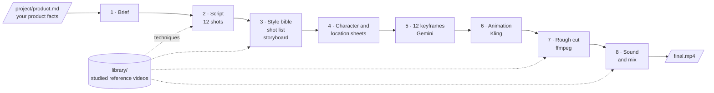
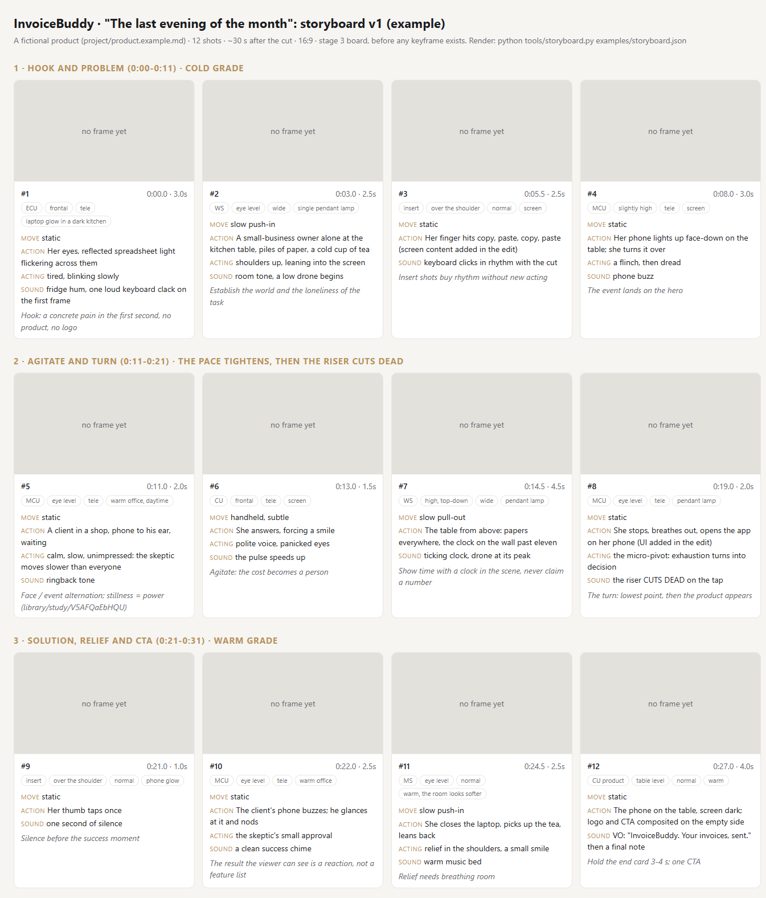

# Dudu Director: an AI video director for Claude Code

[](LICENSE)


**Dudu** is a promo-video director that runs inside [Claude Code](https://claude.com/claude-code). You describe your product; Dudu takes you from a brief to a finished, edited promo film:

- writes the brief and a 12-shot script,
- builds consistent characters, locations and a camera-and-acting storyboard,
- generates the keyframes in **Gemini (Nano Banana)** and animates them in **Kling**, driving the browser itself through Playwright,
- measures every clip, cuts it to the action and assembles the film with **ffmpeg**,
- designs the sound and mixes music, effects and voices onto the cut.

You stay the producer: you log in to the sites, approve every stage and every credit spend, and Dudu does the rest. It also **learns from reference videos**: paste a link to an ad you like, and Dudu breaks it down shot by shot and reuses the techniques.

> The kit was extracted from a real production: a 12-shot brand film taken from an empty folder to a 31-second edited cut. Every rule in the skills is a lesson from that run.

---

## Contents
1. [How it works](#how-it-works)
2. [What a session looks like](#what-a-session-looks-like)
3. [Installation](#installation)
4. [Your first film](#your-first-film)
5. [Teach Dudu with reference videos](#teach-dudu-with-reference-videos)
6. [The tools on their own](#the-tools-on-their-own)
7. [What it cost us](#what-it-cost-us)
8. [Lessons from the first production](#lessons-from-the-first-production)
9. [Troubleshooting](#troubleshooting)
10. [Responsible use](#responsible-use)
11. [Repository layout](#repository-layout)

---

## How it works

Dudu is a Claude Code **agent** (`.claude/agents/dudu-director.md`) plus one **skill** per craft (script, visuals, browser, motion, edit, sound, review, study). It works in nine stages. Every stage ends at a **gate**: Dudu shows you the result and moves on only after you say OK.



Stage 9, **review**, runs at every gate: Dudu checks the script's claims against your product facts, looks at every image and every clip itself, and writes keep / fix / regenerate decisions to `project/qa-notes.md`.

| Stage | Dudu does | You do |
|---|---|---|
| 1-2 Brief and script | Interviews you (6 short questions, each with a recommended answer), offers 3-5 hooks, writes the script | Choose, change, approve |
| 3 Storyboard | Camera, acting and sound direction for every shot, rendered as an HTML board | Approve the board |
| 4-5 Images | Writes the prompts, drives Gemini in the browser, uploads references, downloads and inspects every image, fixes problems with targeted edits | Log in to Gemini once |
| 6 Animation | Runs a one-shot model test first, states the credit cost, then animates all shots in Kling | Log in to Kling, approve the spend |
| 7 Edit | Measures where each clip really moves, cuts each shot to its action, color-grades, assembles | Watch and comment |
| 8 Sound | Writes a cue sheet synced to the cuts, helps you source music, effects and voice, mixes and normalizes | Record or approve voices |

Here is what a stage-3 storyboard board looks like, rendered from [`examples/storyboard.json`](examples/storyboard.json) for a fictional product. Once the keyframes exist, the grey panels are replaced by the real frames.



---

## What a session looks like

An illustrative, shortened exchange. Dudu answers in the language you write in, so you can work in English, Hebrew or any other language. Prompts sent to the image and video models are always in English, because the models follow English best.

```text
you  › /dudu
Dudu › Dudu here. There's no project/product.md yet, so we're before the brief.
       Shall I ask you five quick questions about the product, or will you copy
       project/product.example.md and fill it in?

you  › Use the example product, InvoiceBuddy.
Dudu › Brief, question 1 of 6: which pain is the film about?
         A. End of the month, dozens of unsent invoices   ← recommended, most visual
         B. Money stuck because nobody sent a reminder
         C. A whole evening of copy-paste from a spreadsheet

   ...  brief, script and storyboard, each approved at its gate  ...

Dudu › Stage 5. Please log in to Gemini in the Playwright browser window and
       tell me when you're done. I never type passwords.
you  › done
Dudu › 12 of 12 keyframes kept. I regenerated KF06: an extra looked like the
       hero's twin. Next: a test of the hardest shot in Kling. Cost: 40 credits.
       Go ahead?

   ...  animation, then the edit  ...

Dudu › roughcut-v2.mp4 is ready, 31.2 s. The motion report showed 2.5 s of dead
       time in shots 2 and 10, so I cut both to the action.
```

---

## Installation

Plan about 15 minutes. You need:

| Requirement | Why | Check |
|---|---|---|
| [Claude Code](https://claude.com/claude-code) with a Claude plan or API account that includes it | Runs Dudu | `claude --version` |
| [Node.js](https://nodejs.org) 18 or newer | Runs the Playwright browser server (`npx @playwright/mcp`) | `node -v` |
| [Python](https://www.python.org/downloads/) 3.10 or newer | Runs the video tools | `python --version` (Windows) / `python3 --version` (macOS, Linux) |
| [Git](https://git-scm.com/downloads) | Clones this repository | `git --version` |
| A Google account with Gemini image generation, and a [Kling](https://kling.ai) account with credits | Images and animation. Needed from stage 4, so you can start without them | |

ffmpeg is **not** a separate install: the `imageio-ffmpeg` package ships a portable copy.

### 1. Install Claude Code
Follow the official instructions at [claude.com/claude-code](https://claude.com/claude-code), then run `claude` once in any folder to sign in.

### 2. Clone the kit
```bash
git clone https://github.com/EyalZameret/Dudu-Director-Video-kit.git
cd Dudu-Director-Video-kit
```

### 3. Install the Python packages
A virtual environment keeps the packages inside the project folder.

**macOS / Linux**
```bash
python3 -m venv .venv
source .venv/bin/activate
pip install -r requirements.txt
```

**Windows (PowerShell)**
```powershell
python -m venv .venv
.venv\Scripts\Activate.ps1
pip install -r requirements.txt
```
If PowerShell refuses to run `Activate.ps1`, run `Set-ExecutionPolicy -Scope CurrentUser RemoteSigned` once and try again.

This installs `imageio-ffmpeg` (a portable ffmpeg) and `yt-dlp` (used only to study reference videos).

### 4. Check that everything works
With the environment still active:
```bash
python -c "import imageio_ffmpeg, yt_dlp; print('ready')"
python tools/storyboard.py examples/storyboard.json
```
The second command writes `examples/storyboard.html`. Open it in your browser: you should see the board shown above.

### 5. Start Claude Code and approve the browser server
Start Claude Code **from the same terminal** (so it uses the environment you just activated):
```bash
claude
```
On the first start, Claude Code asks whether you trust the folder and whether to enable the `playwright` MCP server defined in `.mcp.json`. Approve both. To check the server later, type `/mcp`; `playwright` should be listed as connected.

Next time you only need: `cd Dudu-Director-Video-kit`, activate the environment, `claude`.

---

## Your first film

1. Describe your product. Either copy `project/product.example.md` to `project/product.md` and replace the example with your facts, or let Dudu interview you.
2. In Claude Code, type:
   ```
   /dudu
   ```
   Dudu checks which stage the project is at and continues from there. You can stop at any time and resume in a new session.
3. Answer at each gate. When Dudu opens Gemini or Kling, log in **in the browser window Playwright opened**, then tell Dudu you're done.
4. Your film and every intermediate file are in `project/`. That folder is ignored by Git, so your product details, images and videos stay on your machine.

To leave Dudu mode, type `exit Dudu` (or the same in your language) or run any other slash command. You can also start a session directly as Dudu with `claude --agent dudu-director`.

---

## Teach Dudu with reference videos

Paste a link to a video (YouTube and most video sites) and write "learn from this". Claude can't watch a link, so Dudu uses `tools/study_video.py` to give itself eyes and ears:

1. Downloads the video for private analysis, and deletes it at the end.
2. Detects every cut, measures shot lengths and saves one frame per shot.
3. Measures the sound: loudness over time, silences, a waveform and a spectrogram aligned to the cuts. If you agree, it also asks Gemini, which can listen to YouTube videos, and cross-checks the two sources.
4. Analyzes five crafts: directing, camera, acting, storyboard and sound.
5. Writes `analysis.md` and a full `storyboard.json` to `library/study/<video-id>/`, and adds a row to `library/INDEX.md`.

From then on, Dudu checks the library when it writes a script, a storyboard, a cut or a sound plan, and says which technique it borrowed and from where. The more references you add, the sharper the director gets.

> "Learning" here means a library of files Dudu reads every time, not training the model. At the end of a project Dudu also proposes lessons to add to its skill files, and writes them once you agree.

The library ships with one study: [Apex by The Dor Brothers](library/study/V5AFQaEbHQU/analysis.md), a fully AI-generated action short: 73 shots, 3.7 cuts per 10 seconds, and a pace that works as a curve rather than a constant. Only the written analysis is included; frames and footage are never redistributed.

---

## The tools on their own

The Python tools work without Dudu. Run them from the repository root.

| Command | What it does |
|---|---|
| `python tools/study_video.py "<link>"` | Breaks a reference video into shots, frames and sound measurements |
| `python tools/storyboard.py <storyboard.json>` | Renders a storyboard board to HTML |
| `python tools/motion_report.py "project/clips/*.mp4"` | Prints how much each clip moves per half second, to find dead time |
| `python tools/contact_sheet.py project/clips/shot01.mp4` | Makes a single-image contact sheet of a clip for review |
| `python tools/download.py "<url>" project/clips/shot01.mp4` | Downloads a generated clip from its CDN address |
| `python tools/build_cut.py project/cut.json` | Assembles clips and stills into a graded 1080p cut (format: `project/cut.example.json`) |
| `python tools/mix_audio.py project/sound.json` | Mixes music, effects and voices onto the cut, normalized to -14 LUFS (format in the file's header) |

Illustrative output of `motion_report.py` (values are mean frame difference per half second; below 0.5 is frozen, 3 and up is real action):
```text
project/clips/shot02.mp4  (5.0s)
    0.3  0.2  0.3  0.4  2.8  4.1  3.9  1.2  0.4  0.3
```
Here only seconds 2 to 3.5 carry action, so that is the part that goes into the cut.

---

## What it cost us
From the first production, October 2026. Prices change, so check them in each app.

- **Gemini:** about 40 image generations and edits for the whole film, within a subscription.
- **Kling 3.0:** 1080p, 5-second clips, Native Audio off: 40 credits per clip. 12 shots plus one model test and two retakes came to about 600 credits.
- **ffmpeg and the tools:** free.

Dudu states the price before every paid generation and checks it on the Generate button before clicking.

---

## Lessons from the first production

| Stage | What happened | What we learned |
|---|---|---|
| Building the agent | Reviewed existing directing and scriptwriting skills, then built one agent with a skill per stage | One orchestrating agent with approval gates beats an automatic pipeline that never stops |
| Brief | A short interview: one pain, a hero, a skeptic, a proof moment, one CTA | Decide up front whether the film shows only what the product does today, or the vision, and record the decision |
| Script | 12 shots, about 70% problem and 30% solution, no narrator | Inner voices ("I hope this works...") need no lip sync and work in any language. The 70/30 split is an industry habit, not a research result |
| Style bible | One fixed English description per character and for the product, pasted word for word into every prompt | Consistency comes from repeating the exact same description, not from the model's memory |
| Character sheets | Four panels per character: front, three-quarter, profile, close-up | Nationality words do little; describe face, skin, hair, build and clothes. When the model keeps returning the same picture, start a new chat |
| Locations | Two invented offices were rejected; a real photo of the kind of place we wanted worked at once | A real photo as reference beats any description. Logos that sneak in are removed with a targeted edit |
| Browser automation | The owner logged in; Claude chose the tool, uploaded references, sent the prompt and downloaded | Order matters in Gemini: choose image creation first, then send the prompt, or it answers in text and hangs |
| Keyframes | 20-40 seconds per image; Claude checked each one and fixed three | Check the physical truth your audience knows (ports, hands, devices) and look for extras who resemble a main character |
| Model test | The same hard shot in Kling and in Veo | Kling kept the face and the room at 1080p; Veo acted the scene nicely but drifted the face and re-framed the room, at 720p |
| Animation | 12 clips, about 75 seconds each | The product changed shape twice. After one failed retake, the fix was the keyframe still with a slow zoom in the edit |
| First cut | 52 seconds, cold grade for the problem, warm for the solution | |
| "Blue blotches" | Seen in an old media player | A frame with saturation boosted 4x was clean: the player's decoder was at fault. We still re-encoded with a widely compatible profile |
| "The cuts feel slow" | Measured motion per half second: only about 30 of 52 seconds had action | Cut by action, not by clock. The film became 31 seconds, with a pace that builds tension |

---

## Troubleshooting

| Problem | Fix |
|---|---|
| Dudu says it has no browser tools | Type `/mcp` and check that `playwright` is connected. If it is missing, restart `claude` from the repository folder and approve the server. Make sure `node -v` works in that terminal |
| `pip install` fails with "externally-managed-environment" | Use the virtual environment from step 3 instead of installing system-wide |
| `ModuleNotFoundError: imageio_ffmpeg` while Dudu works | Claude Code was started from a terminal where the environment wasn't active. Exit, activate it, start `claude` again |
| Gemini answers in text instead of making an image | Start a new chat and choose image creation before sending the prompt. Dudu does this, but web UIs change |
| A Gemini or Kling button can't be found | The site changed. Dudu takes a snapshot, finds the new button and updates `.claude/skills/dudu-browser/SKILL.md`. The Gemini steps were verified on the Hebrew interface; the English labels are written in but may need this fix once |
| `study_video.py` fails with HTTP 403 | Update yt-dlp (`pip install -U yt-dlp`) and make sure Node.js is on your PATH; it is needed to pass YouTube's checks |
| Blue blotches in dark areas of the film | Usually the media player. Try another player before re-rendering |

---

## Responsible use

- **Passwords:** you log in yourself. Dudu never types passwords, codes or card numbers.
- **Terms of service:** automating consumer web interfaces may conflict with a site's terms. Keep volumes at a human scale, or use the official APIs.
- **Reference videos:** downloads are for private analysis only and are deleted right away. Downloading may conflict with a site's terms. Never reuse other people's footage, music or likenesses; study only the technique.
- **Truth in advertising:** no numbers without a source, no "fixes everything", no real people and no third-party brands in generated images. If you choose to show a planned capability, Dudu records that decision in your brief.
- **Voices:** never clone a real person's voice without their written consent.

---

## Repository layout

```text
.claude/agents/dudu-director.md   The director: stages, gates, rules
.claude/skills/dudu/              /dudu switches the session into Dudu mode
.claude/skills/dudu-script/       Brief and script
.claude/skills/dudu-visuals/      Style bible, characters, locations, storyboard, keyframes
.claude/skills/dudu-browser/      Playwright recipes for Gemini and Kling
.claude/skills/dudu-motion/       Model choice, motion prompts, clip review
.claude/skills/dudu-edit/         Motion measurement, cutting, grading, assembly
.claude/skills/dudu-sound/        Sound design, sourcing and mix
.claude/skills/dudu-review/       Claim, image and clip checks
.claude/skills/dudu-study/        Learning from reference videos
library/                          Dudu's reference library (INDEX.md and analyses)
examples/                         A sample storyboard for a fictional product
tools/                            Python and ffmpeg tools
project/                          Your film (ignored by Git, except the examples)
.mcp.json                         The Playwright browser server
```

---

## License

[MIT](LICENSE). Built with [Claude Code](https://claude.com/claude-code). The reference study analyzes *Apex* by The Dor Brothers for educational purposes; no footage, frames or audio from it are included.
